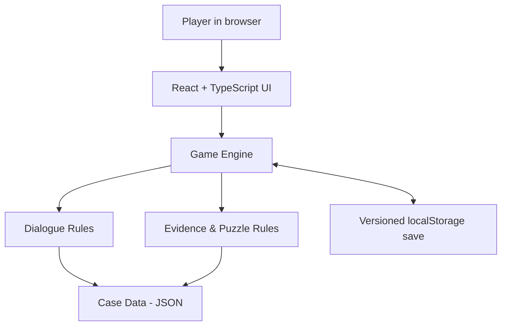

<div align="center">

# 🕵️ Digital Detective

### Every clue matters. Every answer raises another question.

**An interactive, browser-based detective mystery where you investigate suspects, uncover evidence, solve forensic puzzles, and piece together the truth.**

[](https://digital-detectivea.vercel.app/)
[](https://react.dev/)
[](https://vite.dev/)
[](https://vercel.com/)

**[▶ PLAY NOW](https://digital-detectivea.vercel.app/)** · **[Explore the source](https://github.com/nirregen/digital-detective)**

*No sign-up. No installation. Just an investigation.*

</div>

---

## 🔎 The case: *The Last Message*

A software engineer at **Northstar Systems** disappears after a suspicious resignation email. Three colleagues tell different versions of what happened that night.

You have the records. You have the suspects. But can you connect the evidence before reaching a verdict?

> **Your mission:** investigate the disappearance, challenge contradictory statements, and support your conclusion with evidence.

### What you can do

- **Interrogate three suspects** through branching, character-specific dialogue.
- **Uncover eight pieces of evidence** hidden behind investigation milestones.
- **Solve two forensic puzzles** to unlock new information.
- **Confront contradictions**: certain questions become available only after discovering relevant evidence.
- **Track witness responses** with persistent dialogue history and character trust/pressure values.
- **Resume your investigation** after refreshing or leaving the page, using local browser saves.
- **Submit a final verdict** based on what you discovered.

All characters, organizations, and events are fictional.

## 🎮 Try it in your browser

### [Launch Digital Detective →](https://digital-detectivea.vercel.app/)

The game runs as a static web app. You don't need an account, a local server, Docker, or an AI API key.

**Quick challenge:** Find a discrepancy in a suspect's timeline, then use the right evidence to unlock a new interrogation option.

## 🛠️ Engineering highlights

Digital Detective is more than a set of screens. It is a **data-driven investigation engine** with explicit rules for what players can discover and when.

| Engineering area | Implementation |
| --- | --- |
| **State management** | Game progress, evidence, solved puzzles, witness transcripts, and verdict state |
| **Rule-based dialogue** | Scripted branching choices with evidence-gated revelations |
| **Game logic** | TypeScript engine validates puzzle progress and investigation conditions |
| **Persistence** | Versioned `localStorage` saves, restored when the app reloads |
| **Separation of concerns** | UI, game engine, and case content are organized separately |
| **Quality and delivery** | Automated frontend tests, production build, and GitHub-based deployment |

### Architecture



**Why this architecture?** An earlier prototype used FastAPI, SQLite, Docker, and locally hosted language models. For a portfolio game that anyone should be able to try instantly, I redesigned the runtime as a static React application. The result removes infrastructure dependencies and unpredictable AI responses while retaining structured investigation logic.

The earlier prototype remains part of the repository's Git history and demonstrates the design evolution.

## 💻 Tech stack

- **Frontend:** React, TypeScript, Vite
- **Game content:** JSON-driven cases and dialogue rules
- **Storage:** browser `localStorage`
- **Testing:** Vitest and GitHub Actions
- **Deployment:** Vercel

## 🚀 Run locally

Requirements: Node.js and npm.

```bash
# Clone the repository
git clone https://github.com/nirregen/digital-detective.git
cd digital-detective/frontend

# Install dependencies
npm install

# Start the development server
npm run dev
```

Open the local URL printed by Vite (usually `http://localhost:5173`).

```bash
# Run automated tests
npm run test

# Build for production
npm run build
```

No backend or environment variables are needed to run the **Static Edition**.

## 🗂️ Project structure

```text
frontend/
├── src/
│   ├── game/           # Investigation rules, state, and persistence
│   ├── data/           # Case facts, characters, and dialogue content
│   └── ...             # React screens and interface components
├── package.json
└── ...
.github/workflows/      # Automated checks
README.md
```

Legacy backend files may still be present in the repository for reference; the deployed static game does not depend on them.

## 🧭 Roadmap

- [x] Case 001: *The Last Message*
- [x] Evidence collection and forensic puzzles
- [x] Evidence-gated branching dialogue
- [x] Persistent browser saves
- [x] Static deployment with a public demo
- [ ] Visual evidence board for connecting clues
- [ ] More dialogue branches and consequence-driven choices
- [ ] Accessibility and end-to-end test coverage
- [ ] More investigations and a reusable case-authoring format

## ⚖️ Design trade-offs

- **Browser-only saves:** Progress persists in the same browser, but does not sync across devices or survive clearing site data.
- **Static case data:** Puzzle solutions are included in the browser bundle and can be inspected by technically inclined players. This is an intentional trade-off for a frictionless portfolio demo.
- **Deterministic dialogue:** Scripted responses prioritize coherence and reliable gameplay over unrestricted AI-generated conversation.

## 👨‍💻 About this project

I built Digital Detective to practice designing an interactive product end to end: from game rules and state management to testing, deployment, and technical trade-offs. It continues to evolve through incremental features and documented improvements.

**[Play the live demo](https://digital-detectivea.vercel.app/)** · **[View repository](https://github.com/nirregen/digital-detective)**
